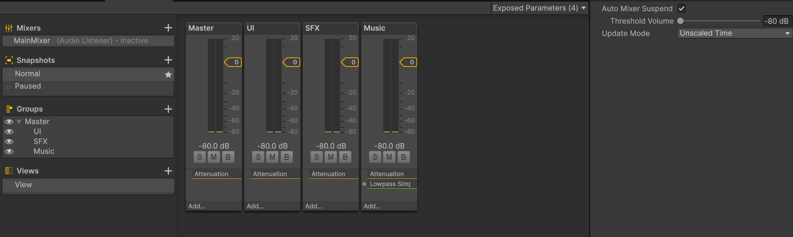

# ITU-CS-464-LAB-08-BSCS25017

**JET LAB** (mobile game menu system) · CS 464 Lab 08, built on top of my completed Lab 07 project.
**Unity version:** Unity 6.3 LTS - 6000.3.24f1 | Render pipeline: URP
**Demo video:** https://drive.google.com/file/d/1LYVsb-4KCKRpfNF6DOr3ASuGGGVHdGNz/view?usp=drive_link

> Jetpack Joyride is inspiration only. No copied assets, no AI images. All motion and audio logic is my own code; audio files are third-party and credited in section 7.

**Contents:** 1 Unity version and setup · 2 Loading flow · 3 Mixer groups · 4 Volume mapping · 5 Music transitions · 6 C# events · 7 Asset credits

---

## 1. Unity version and setup steps

1. Clone the repo and open the folder in **Unity 6.3 LTS (6000.3.24f1)** with the Universal Render Pipeline (Unity Hub → Add).
2. Wait for the import to finish. The Console should be empty.
3. Open `Assets/Scenes/Game.unity` and press **Play**.
4. **Build Profiles → Scene List** must contain `Game` (index 0) and `Gameplay` (index 1). They are already added.
5. Portrait, reference resolution 1080 × 1920. In the Game view use a 9:16 or 3:4 aspect.

**Controls (for testing):** hold the mouse or finger anywhere on the screen to fly up, release to fall. Dodge coral zappers, collect gold coins. The `TAKE HIT` and `+ COIN` buttons are kept as test shortcuts.

---

## 2. Loading flow

```
Loadout: START RUN
  → SceneLoader.BeginRun()
      · gameplay already loaded? (retry) → GameSession.StartRun() immediately
      · otherwise:
  → UIManager.SetState(Loading)                      (Loading panel appears)
  → SceneManager.LoadSceneAsync("Gameplay", Additive), allowSceneActivation = false
  → loop: shown = MoveTowards(shown, min(op.progress / 0.9, elapsed / minShowSeconds))
          SceneLoader.Progress?.Invoke(shown)        (LoadingUI updates bar + %)
  → shown reaches 1 → wait 0.15 s → allowSceneActivation = true → wait for op.isDone
  → GameSession.StartRun()                           (only now: state = Playing)
```

- **Additive on purpose.** The `Game` scene holds `UIManager`, all panels, tweens and audio objects. Reloading it would destroy them, so the world lives in a second scene (`Gameplay`) that is loaded and unloaded around it.
- **Real progress.** `AsyncOperation.progress` stops at 0.9 while activation is held back, so the value shown is `progress / 0.9`. A minimum display time (1.2 s) and `MoveTowards` smoothing keep a tiny scene from flashing past; the displayed value never runs ahead of the real progress.
- **No early entry.** The state stays `Loading` until `op.isDone`; `GameSession.StartRun()` (which sets `Playing`) is the last line of the coroutine.
- **Unload.** When the state returns to `Menu`, the Gameplay scene is unloaded, so the next START RUN shows loading again.

---

## 3. Mixer groups

One mixer, `Assets/Audio/Mixer/MainMixer`:

```
Master
 ├─ Music
 ├─ SFX
 └─ UI
```

| Group | Exposed parameter | Receives |
|---|---|---|
| Master | `MasterVolume` | everything |
| Music | `MusicVolume` | `MusicA`, `MusicB` (crossfade pair) |
| SFX | `SfxVolume` | `Src0`–`Src3` (rotating pool for gameplay effects) |
| UI | `UiVolume` | `Ui0`, `Ui1` (rotating pool for UI sounds) |

Every `AudioSource` has its **Output** set to one of these groups, Play On Awake off, Spatial Blend 0.

**Snapshots:** `Normal` and `Paused`. `Paused` applies a Lowpass (900 Hz) and −6 dB (a second, un-exposed Attenuation) to the Music group. The mixer's **Update Mode is Unscaled Time** so the blend works while `Time.timeScale = 0`.



---

## 4. Volume mapping

Sliders store a **linear 0.0001 – 1** value. It is converted to decibels with

```
dB = 20 · log10(v)
```

| Slider | dB |
|---|---|
| 1.0 | 0 dB |
| 0.5 | −6 dB |
| 0.25 | −12 dB |
| 0.1 | −20 dB |
| 0.0001 | −80 dB |

- The slider minimum is **0.0001**, never 0, because `log10(0)` is −infinity.
- **Mute** is a separate saved flag that sets Master to −80 dB. It never touches the slider values, so unmuting restores them.
- **Persistence:** `PlayerPrefs` keys `vol_MasterVolume`, `vol_MusicVolume`, `vol_SfxVolume`, `vol_UiVolume` and `audio_muted`. `AudioBootstrap` applies them at start (and once more a frame later), so saved volumes are in effect before Settings is ever opened. Prefs are saved when Settings closes, on app pause and on quit.
- `AudioListener.volume` is **not** used anywhere.

Code: `Assets/Scripts/Audio/MixerVolumes.cs`, `SettingsUI.cs`.

---

## 5. Music transitions

Two looping sources are crossfaded with an **equal-power** curve (cos/sin, 1.5 s, unscaled time).

| State entered | Track |
|---|---|
| Menu and all sub-screens | `MenuLoop.ogg` |
| Playing | `GamePlayLoop.ogg` (no restart on Resume) |
| Over | `ResultsLoop.ogg` |
| Loading / Paused / Confirm | keep what is playing |

Flow: **menu → (loading, menu music continues) → gameplay → results → menu / retry.**

---

## 6. C# events: publishers and subscribers

`GameSession` (the core system) no longer updates the HUD, buzzes the phone or plays sounds. It changes state and raises events; independent listeners react. Events are `public static event Action<…>`, invoked with `?.Invoke(…)`, subscribed with `+=` in `OnEnable` and unsubscribed with `-=` in `OnDisable`.

| Publisher | Event | Subscribers |
|---|---|---|
| `GameSession` | `GameStarted` | `HudListener`, `WorldSpawner`, `PilotController`, `GameplaySfx` |
| `GameSession` | `Damaged(current, max)` | `HudListener`, `HitFlash`, `CameraShake`, `HapticsListener`, `GameplaySfx` |
| `GameSession` | `CoinCollected(coins)` | `HudListener`, `GameplaySfx` |
| `GameSession` | `GameLost(meters, coins, newBest)` | `CameraShake`, `GameplaySfx` |
| `HoldZone` | `HoldChanged(bool)` | `PilotController`, `GameplaySfx` |
| `UIManager` | `StateChanged(previous, next)` | `UiSounds`, `AudioBootstrap`, `MusicDirector`, `SceneLoader` |
| `SceneLoader` | `Progress(float)` | `LoadingUI` |

Independent listeners that respond to a hit: **UI** (`HudListener`: health bar, lag bar, punch), **sound** (`GameplaySfx`), **screen flash** (`HitFlash`), **camera shake** (`CameraShake`), **haptics** (`HapticsListener`).

Static events outlive scene changes, so the `OnDisable` unsubscribe is mandatory; forgetting it causes `MissingReferenceException` after a restart. I verified by retrying several times in a row with an empty Console.

### Code excerpt

```csharp
// GameSession.cs — publisher
public static event Action<int, int> Damaged;       // current health, max health
...
public void TakeHit()
{
    if (UIManager.Instance.State != GameState.Playing) return;
    health = Mathf.Max(0, health - 1);
    Damaged?.Invoke(health, MaxHealth);             // safe invoke
    if (health == 0) EndRun();
}

// HitFlash.cs — subscriber
void OnEnable()  => GameSession.Damaged += Flash;
void OnDisable() => GameSession.Damaged -= Flash;   // unsubscribe pair
void Flash(int current, int max) => SetAlpha(alpha);
```

---

## 7. Asset credits

The following table documents the audio assets used in this project. Every file is third-party; no audio from commercial games is used.

| # | Audio File | Category | Usage | Author / Source | Source URL | Licence | Edited |
|---:|---|---|---|---|---|---|---|
| 1 | Hover.ogg | UI | Hover | leohpaz - "10 Retro RPG Menu Sounds" (OpenGameArt) | [Link](https://opengameart.org/content/10-retro-rpg-menu-sounds) | CC-BY 4.0 | No |
| 2 | Click.ogg | UI | Click | Kenney.nl | [Link](https://kenney.nl/assets) | CC0 | No |
| 3 | Back.ogg | UI | Back | Kenney.nl | [Link](https://kenney.nl/assets) | CC0 | No |
| 4 | Open.ogg | UI | Open | Kenney.nl | [Link](https://kenney.nl/assets) | CC0 | No |
| 5 | Close.ogg | UI | Close | Kenney.nl | [Link](https://kenney.nl/assets) | CC0 | No |
| 6 | Pause.ogg | UI | Pause | leohpaz - "10 Retro RPG Menu Sounds" (OpenGameArt) | [Link](https://opengameart.org/content/10-retro-rpg-menu-sounds) | CC-BY 4.0 | No |
| 7 | Resume.ogg | UI | Resume | "Cozy Farm SFX" by Bramble & Byte | [Link](https://aquumgifts.itch.io) | CC-BY | No |
| 8 | Success.ogg | UI | Success | Kenney.nl | [Link](https://kenney.nl/assets) | CC0 | No |
| 9 | Error.ogg | UI | Error | Kenney.nl | [Link](https://kenney.nl/assets) | CC0 | No |
| 10 | CoinPickup.ogg | SFX | Coin Pickup | NenadSimic - "Picked Coin Echo 2" (OpenGameArt) | [Link](https://opengameart.org/content/picked-coin-echo-2) | CC-BY 3.0 | No |
| 11 | Death.ogg | SFX | Death | Badre-Eddine - "Hurt / Death sound effect for character" (OpenGameArt) | [Link](https://opengameart.org/content/hurt-death-sound-effect-for-character) | CC0 | No |
| 12 | Hurt.ogg | SFX | Hurt | Exewin - "Death sounds" (OpenGameArt) | [Link](https://opengameart.org/content/death-sounds-0) | CC0 | No |
| 13 | Boost.ogg | SFX | Boost | qubodup - "Up (3x)" (OpenGameArt) | [Link](https://opengameart.org/content/up-3x) | CC0 | No |
| 14 | StartRun.ogg | SFX | Run Start | OpenGameArt (TODO: author from page) | [Link](https://opengameart.org/content/gui-sound-effects-8) | CC0 | No |
| 15 | MenuLoop.ogg | Music | Menu Loop | Akikazer - "Menu Loop" (OpenGameArt) | [Link](https://opengameart.org/content/menu-loop) | CC0 | No |
| 16 | GamePlayLoop.ogg | Music | Gameplay Loop | Trinnox - "Arcade fast flow Sound" (OpenGameArt) | [Link](https://opengameart.org/content/arcade-fast-flow-sound) | CC-BY 3.0 | No |
| 17 | ResultsLoop.ogg | Music | Results Loop | Umplix - "Results (Short Loop)" (OpenGameArt) | [Link](https://opengameart.org/content/results-short-loop) | CC0 | No |

### Attribution required (CC-BY)

- **Hover.ogg** and **Pause.ogg**: "10 Retro RPG Menu Sounds" by leohpaz, https://opengameart.org/content/10-retro-rpg-menu-sounds, licensed CC-BY 4.0.
- **Resume.ogg**: "Cozy Farm SFX" by Bramble & Byte, https://aquumgifts.itch.io (CC-BY).
- **CoinPickup.ogg**: "Picked Coin Echo 2" by NenadSimic, https://opengameart.org/content/picked-coin-echo-2 (CC-BY 3.0).
- **GamePlayLoop.ogg**: "Arcade fast flow Sound" by Trinnox, https://opengameart.org/content/arcade-fast-flow-sound (CC-BY 3.0). The author asks to be credited as "Trinnox" and optionally linked to http://opengameart.org/users/trinnox.

All other files are CC0 (no attribution required, credited anyway). Kenney assets: https://kenney.nl/assets (CC0).

### Notes on attribution

- Licences and authors are copied from each source page as shown on the download date (TODO date). Where a page does not state a separate author or attribution wording, the uploader's username on that page is credited as the author and the page link is given as the source.
- No audio from commercial games was used and no audio file was edited.
